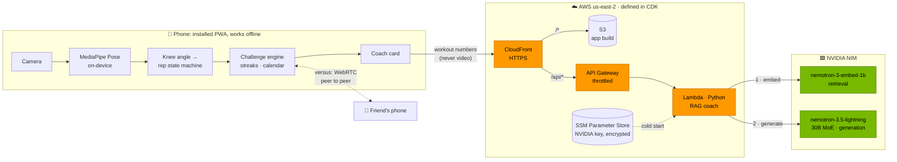

# 🏋🏾 Squat Challenge

A 30-day squat challenge that **counts your reps with computer vision**. Prop your phone up, step
back, and squat — a pose model tracks your body, checks your depth, and counts each rep in real
time. Everything runs on the device; no video is recorded or uploaded.

Installs to the home screen as a PWA, so it behaves like a native app without an app store.

**Live:** https://d16oowfiirb0bb.cloudfront.net (open on a phone; served from S3 + CloudFront, deployed with AWS CDK)

**AI coach:** after each set, the app shows advice from [`coach/`](coach/), a Python RAG service on AWS Lambda that retrieves exercise guidance and generates advice with **NVIDIA Nemotron through NIM**.

---

## Architecture



- **Vision stays on the phone.** Pose detection runs in the browser, so video never leaves the
  device, inference is free, and the app works offline.
- **Language goes to the cloud.** After a set, only the numbers (day, reps, depth, streak) go to
  `/api/coach`. The Lambda retrieves matching guidance with NVIDIA's embedding model and has
  Nemotron write the advice: retrieval-augmented generation (RAG). Details in [`coach/`](coach/).
- **One domain.** CloudFront serves the app and routes `/api/*` to API Gateway, so there's no CORS
  and no API URL in the build. The NVIDIA key lives encrypted in Parameter Store, readable only by
  the coach Lambda.
- **Versus is peer to peer.** A public broker (PeerJS) introduces the two phones; rep counts then go
  directly between them over WebRTC.
- **Also provisioned:** DynamoDB, Cognito (passwordless sign-in) and a budget alarm, ready for
  cloud sync.

Design decisions and trade-offs are recorded in [`docs/architecture.md`](docs/architecture.md).

---

## What it actually does

```
camera frame → 33 pose landmarks → knee angle → state machine → rep
                                                      ↓
                                 challenge engine → streak, calendar, progress
```

The two halves are deliberately independent. The challenge engine knows nothing about cameras, so
**the app is a working product even where pose detection isn't** — there's a manual counter and a
`+1` button for reps the camera misses.

### Rep counting

Counting per frame doesn't work: at 30fps one squat spans ~40 frames, so a naive threshold counts
one squat forty times. Instead the knee angle (hip → knee → ankle) drives a hysteretic state
machine:

```
standing ──angle < 150°──▶ descending ──angle ≤ 100°──▶ bottom
   ▲                            │                         │
   │                      stood back up             rose past 108°
   │                      without depth                   ▼
   └────── +1 rep ◀── angle ≥ 160° ────────────────── ascending
```

A rep only counts when the signal completes the whole journey. Everything else is a guard against a
specific failure seen in testing:

| Guard | Stops |
| --- | --- |
| 8° release margin leaving the bottom | Hovering at the threshold ratcheting the counter |
| `minRepMs` (400ms) | Landmark jitter registering as an impossibly fast rep |
| `maxRepMs` (10s) | A "rep" that is really the user sitting down |
| Upright baseline before arming | A phantom rep when you open the camera already crouched |
| Framing gate | A half-visible body producing angles that look like squats |
| EMA smoothing (α=0.5) | Single-frame landmark spikes |
| Min of both knees, not the mean | An occluded far leg washing out real depth when side-on |

All of it is [unit-tested](src/cv/squatDetector.test.ts) against synthetic rep waveforms — dropped
frames, half-reps, double dips, hovering, noise.

---

## Run it

```bash
npm install          # also vendors the MediaPipe WASM runtime
npm run assets:model # downloads the pose model (~6MB) into public/models
npm run dev          # http://localhost:5173
```

**On your phone** (where it's actually meant to be used) — the camera needs a secure context, so
plain http over the LAN won't do:

```bash
npm run dev:lan      # serves over HTTPS on your LAN IP; accept the self-signed cert
```

Or deploy the static build anywhere: `npm run build` → serve `dist/`.

### Scripts

| Command | |
| --- | --- |
| `npm run dev` | Dev server |
| `npm run dev:lan` | Dev server over HTTPS, reachable from a phone |
| `npm run build` | Vendors assets, type-checks, builds `dist/` |
| `npm test` | Unit tests |
| `npm run check` | Types + lint + tests (the one to run before shipping) |
| `npm run assets:icons` | Regenerates the PWA icons from vector source |

---

## Stack

| | |
| --- | --- |
| **UI** | React 19 + TypeScript, hash routing, hand-rolled CSS (no UI framework) |
| **CV** | MediaPipe Pose Landmarker (lite, float16) via `@mediapipe/tasks-vision`, GPU with CPU fallback |
| **State** | Zustand, persisted to localStorage |
| **PWA** | `vite-plugin-pwa`; app shell precached, model and WASM cached on first use |
| **AI coach** | Python RAG service: NVIDIA Nemotron via NIM (embeddings + generation), Hugging Face locally, FastAPI · [`coach/`](coach/) |
| **Cloud** | AWS via CDK: CloudFront, S3, API Gateway, Lambda, SSM, DynamoDB, Cognito, Budgets · [`infra/`](infra/) |
| **Versus** | PeerJS (WebRTC data channel), lazy-loaded |
| **Tests** | 210 total: Vitest (181, app), pytest (16, coach), CDK assertions (13, infra) |

### Why a PWA and not React Native

The outline called for Expo. Running MediaPipe in React Native needs a custom native frame-processor
plugin and a dev-client build — hours of native wiring before a single rep gets counted, and no iOS
builds from a Windows machine. In the browser the same model runs GPU-accelerated on-device, a judge
can open it on their own phone from a link, and the entire CV core
(`src/cv/`, `src/challenge/`) is plain TypeScript that ports to React Native unchanged if the
project later moves.

---

## Project layout

```
src/
├── cv/                     # camera → landmarks → angles → reps
│   ├── poseEngine.ts       # MediaPipe wrapper (timestamps, GPU fallback)
│   ├── angles.ts           # joint geometry + EMA smoothing
│   ├── squatDetector.ts    # the rep state machine          ← the interesting bit
│   ├── formFeedback.ts     # framing checks and coaching copy
│   ├── landmarks.ts        # pose index map
│   └── useSquatSession.ts  # the React ↔ 30fps-loop bridge
├── challenge/              # pure, camera-free challenge rules
│   ├── plan.ts             # the 30-day progression
│   ├── engine.ts           # days, targets, completion, stats
│   └── streak.ts           # streak arithmetic
├── screens/                # Onboarding · Home · Workout · Progress · Settings
├── components/             # progress bar, calendar, stat tiles, celebration
├── services/               # notifications, optional Supabase sync
├── store/                  # Zustand store (persistence only; rules live above)
└── utils/                  # local-calendar dates, audio/haptic feedback
scripts/                    # asset vendoring + dependency-free PNG icon generator
supabase/schema.sql         # optional cloud sync, with RLS
```

### Performance note

Inference runs at up to 30fps, but re-rendering React 30 times a second to animate a depth bar
starves the model of frame budget. So the frame loop writes into a ref and publishes a snapshot to
React at ~12Hz — except the rep count and framing state, which publish immediately because that's
what the user is waiting on. The skeleton overlay is drawn straight to a canvas and never passes
through React at all.

---

## Live versus

Two people on two phones race through a 60-second squat sprint. One creates a match and shares a
5-letter code (or an invite link), the other joins, both tap ready, and a 3-second countdown starts
both clocks. Each phone counts its own reps with its own camera and sends only the number.

- **No backend.** PeerJS's free public broker introduces the two browsers, then counts go
  phone-to-phone over a WebRTC data channel. Some strict carrier/corporate networks block that
  direct link, so the app tells you to switch one phone between Wi-Fi and mobile data.
- **The match is a pure reducer** ([`src/versus/match.ts`](src/versus/match.ts)), tested by wiring
  two of them back to back, including messages held in flight and simultaneous rematches.
- **Results wait for both final counts**, so neither phone declares a winner from a stale score.
- **Match reps count toward today's challenge**, committed one at a time like a normal workout.
- **Not cheat-proof.** Each phone reports its own count; it's a game between friends.

## Privacy

Camera frames are analysed in memory and discarded. Nothing is recorded, saved, or uploaded — the
model and its runtime are served from the app's own origin, so inference needs no network at all
after first load. Progress lives in this device's localStorage unless you opt into sync.

## Optional: cloud sync (legacy)

From before the move to AWS; superseded by the DynamoDB/Cognito stack in `infra/`.


1. Run [`supabase/schema.sql`](supabase/schema.sql) in the Supabase SQL editor (RLS included).
2. Copy `.env.example` to `.env.local` and fill in the URL and anon key.

Without those variables the client is never constructed and the account UI stays hidden.

---

## Known limits

- **Side-on or front-on works; 45° is weaker.** Angles are measured in the camera plane, so an
  oblique stance foreshortens the knee angle and can read shallow. Fixable with the model's world
  landmarks (3D) — a V2 change, not a V1 one.
- **One person in frame.** `numPoses: 1`; a second body in shot can capture the tracker.
- **Depth is one fixed threshold**, not calibrated per user. Someone with limited ankle mobility may
  need `depthAngle` raised in `DEFAULT_SQUAT_CONFIG`.
- **Reminders fire only while a tab is alive.** Real background push needs a server; the app is
  honest about this in Settings rather than pretending otherwise.
