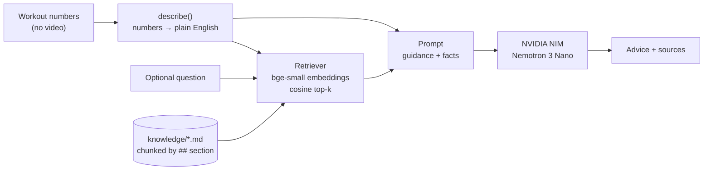

# Coach: RAG with Hugging Face and NVIDIA Nemotron

After a workout, the app sends its numbers (day, reps against target, rep depth, streak, and optionally a question) and gets back two to four sentences of coaching grounded in a small exercise-guidance knowledge base.

```
POST /coach  {"day": 12, "target": 70, "reps_today": 45, "missed_yesterday": true,
              "sessions_today": [{"reps": 45, "average_depth_percent": 78, "duration_seconds": 120}]}

→ {"advice": "You're 25 squats from today's goal, so finish it in smaller sets of 10–15 with a short rest between...",
   "sources": [{"source": "sets-and-pacing.md", "heading": "Sets and pacing: Splitting the daily goal", "score": 0.822}, ...]}
```

## How it works



1. **Describe.** `workout.py` turns the numbers into sentences ("Short of today's goal: 45 of 70… Average depth 78%, shallow reps"). Embedding models and LLMs handle text better than raw JSON, and the same sentences serve as both the search query and the prompt.
2. **Retrieve.** Each `##` section of `knowledge/*.md` is one chunk, embedded once at startup with [`BAAI/bge-small-en-v1.5`](https://huggingface.co/BAAI/bge-small-en-v1.5) through Hugging Face `sentence-transformers`. Search is a dot product over a NumPy matrix. With a dozen chunks a vector database would add a service without adding anything useful.
3. **Generate.** The top three chunks and the facts go to **Nemotron 3 Nano** (`nvidia/nemotron-nano-3-30b-a3b`, a mixture-of-experts model with 30B parameters, about 3B active per token) through NVIDIA NIM. Any `<think>` reasoning in the reply is stripped before it's returned.

### Design notes

- **Question-first retrieval.** In the first version, "my knee hurts" plus the workout numbers was searched as one query, and the numbers drowned out the question, so the pain guidance wasn't retrieved. Now the question is searched on its own first and the results are merged (`Coach._retrieve`, covered by a regression test).
- **One client for hosted and self-hosted.** NIM exposes the OpenAI API, so moving from NVIDIA's hosted endpoint to a NIM container on your own GPU only changes `NIM_BASE_URL`.
- **Privacy.** Only aggregate numbers leave the phone. Pose detection stays on-device.
- **Safety.** The pain guidance tells the user to stop and see a professional, and the system prompt forbids diagnosis.

## Run it

Needs Python 3.11+. These steps use WSL Ubuntu and [uv](https://docs.astral.sh/uv/).

```bash
cd coach
uv venv ~/.venvs/bigsquatter-coach && source ~/.venvs/bigsquatter-coach/bin/activate
uv pip install torch --index-url https://download.pytorch.org/whl/cpu   # CPU is plenty for embeddings
uv pip install -e ".[dev]"

pytest                                     # no API key or model download needed

export NVIDIA_API_KEY=nvapi-...            # free key from https://build.nvidia.com
coach --day 12 --target 70 --reps 45 --depth 78 --missed-yesterday --show-sources
coach --day 9 --target 50 --reps 50 --question "my left knee hurts when I go down"

uvicorn coach.api:app --port 8000          # HTTP API; docs at http://localhost:8000/docs
```

| Variable | Default | |
| --- | --- | --- |
| `NVIDIA_API_KEY` | none | Required for the hosted endpoint |
| `NIM_BASE_URL` | `https://integrate.api.nvidia.com/v1` | Set to e.g. `http://localhost:8000/v1` for a self-hosted NIM container |
| `NIM_MODEL` | `nvidia/nemotron-nano-3-30b-a3b` | Any chat model in the NIM catalogue |

## Tests

`tests/` replaces the Hugging Face model with a hashed bag-of-words embedder and the LLM with a stub, so the suite runs in a couple of seconds offline. It covers chunking, retrieval relevance per document, the workout description, reasoning stripping, question-first retrieval and the HTTP API.
