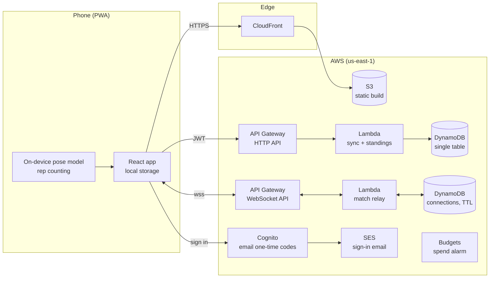

# Squat Challenge on AWS

How the backend is built, and why each choice was made.

## Goals and constraints

| | |
| --- | --- |
| **Local-first** | The app is fully usable with no account and no network. The cloud adds backup, multi-device sync, friends' standings and live versus. It never gates the core loop. |
| **Privacy** | Camera frames never leave the phone. Rep counting runs on-device; the backend only ever sees numbers. |
| **Cost** | ~$0/month at hobby scale, and spend that grows with usage rather than with time. No always-on servers. |
| **Operable by one person** | Managed services only, everything defined as code, nothing configured by hand in the console. |

## Overview



**Status:** the stateful stack (tables, user pool, budget) and the web stack (S3 + CloudFront) are
deployed to us-east-2, and the app is live at https://d16oowfiirb0bb.cloudfront.net. The HTTP API
and the WebSocket relay come next.

## Request flows

**Sync.** After a workout the app `PUT`s its challenge to `/challenge` with a Cognito JWT. The
Lambda writes the challenge item, then updates the user's `MEMBER#` item in each group they belong
to, so reading standings later is one query, not a scan.

**Friends' standings.** Creating a group mints an invite code (stored as `gsi1pk = CODE#…`).
Joining looks the code up on the GSI and writes a member item. `GET /groups/{id}/standings` is a
single `Query` on `pk = GROUP#id`, sorted in the Lambda by days completed, then total reps.

**Live versus.** Both phones open a WebSocket with the match code. `$connect` records the
connection under `MATCH#code`; every message is relayed to the other connection in that match.
The match rules stay in the existing client reducer (`src/versus/match.ts`), so the server is a
thin relay today and can become the referee later (v3).

## Decisions

### ADR-1: Serverless over containers or EC2

Traffic is spiky (evenings, launch days) and tiny on average. Lambda + API Gateway + DynamoDB
scale to zero, so idle costs nothing, and there is no OS, patching or capacity to manage.
*Trade-off:* cold starts (~200–500ms on Node) on the first request after idle. That's acceptable
for a background sync and invisible behind the local-first UI.

### ADR-2: Stateful and stateless stacks are separate

Tables and the user pool live in `SquatChallenge-Stateful`, with termination protection,
deletion protection and `RETAIN` removal policies. Everything rebuildable (API, Lambdas, CDN)
lives in other stacks. A mistaken `cdk destroy` of the app can't delete anyone's data, and the
stateless stacks can be torn down and recreated freely.

### ADR-3: DynamoDB single-table design over a relational database

Every access pattern is known up front and keyed by user or group: get/put my challenge, find a
group by code, list my groups, list a group's members. Each is one `GetItem`/`Query`, on-demand
billing means no capacity planning, and there's no connection pool to exhaust from Lambda.
*Trade-off:* ad-hoc analytics ("average reps on day 12 across all users") is awkward. If that's
ever needed, stream the table to S3 and query it with Athena rather than bending the operational
store.

Standings are **denormalised** onto member items at write time. Writes (a sync after each
workout) are rare and reads (opening the leaderboard) are frequent, so pay the cost once on write.

### ADR-4: Cognito passwordless (email one-time code)

No passwords means nothing to store, reset or leak, and sign-up and sign-in are one flow.
Cognito's Essentials tier supports email OTP natively. *Trade-off:* each sign-in sends an email,
so email deliverability becomes a dependency. Hence SES (ADR-6).

### ADR-5: API Gateway WebSockets for live versus, replacing PeerJS

The current versus build uses WebRTC through PeerJS's free public broker. That works, but it
depends on a third-party server with no SLA, and some carrier networks block direct
phone-to-phone connections. A managed WebSocket relay:

- works on every network (it's ordinary outbound HTTPS),
- removes the third-party dependency,
- puts the server in the path, which v3 needs to referee matches and resist cheating.

*Trade-off:* every message now costs a little (API Gateway bills per message and connection
minute) and adds one hop of latency. A 60-second match sends a few hundred tiny messages, so
cost is negligible, and ~50–100ms extra latency is invisible on a rep counter. The client's
`Transport` interface (`src/versus/transport.ts`) means this is a swap, not a rewrite.

### ADR-6: SES for sign-in email

Cognito's built-in sender is capped at a handful of emails a day — fine for development, broken
for real users. SES starts in a sandbox (verified recipients only), so production access must be
requested before launch. It's a support form; approval usually takes about a day.

### ADR-7: Infrastructure as code with CDK in TypeScript

Same language as the app, real types on every resource, and tests (`infra/test/`) that assert
the properties that must never regress: buckets private, data retained, HTTPS enforced, sign-in
passwordless. Nothing is created by hand in the console.

## Security

- **Least privilege:** each Lambda gets only the table actions it uses (`grantReadWriteData` on
  one table, not `dynamodb:*`).
- **Auth at the edge:** API Gateway's JWT authorizer rejects unsigned requests before any Lambda
  runs; Lambdas trust only the `sub` claim, never a user ID from the request body.
- **No public buckets:** S3 is reachable only through CloudFront Origin Access Control.
- **Encryption:** DynamoDB and S3 encrypt at rest by default; CloudFront enforces HTTPS.
- **Untrusted input:** match messages are validated on arrival (`src/versus/protocol.ts`); the
  same validation runs server-side once the relay exists.
- **Account hygiene:** root account locked away with MFA; day-to-day work through IAM Identity
  Center.

## Cost

Rough monthly cost at 1,000 active users (us-east-1 list prices; verify before quoting):

| Service | Usage | Cost |
| --- | --- | --- |
| CloudFront + S3 | ~20GB transfer (model + app, cached after first load) | free tier / <$2 |
| DynamoDB on-demand | ~50k writes, ~200k reads | <$1 |
| Lambda + HTTP API | ~100k requests | <$1 |
| WebSocket API | ~500 matches × ~500 messages | <$1 |
| Cognito Essentials | 1,000 MAU | free tier |
| SES | ~3,000 emails | <$1 |

A `$5/month` budget alarm (50%, 100%, forecast 100%) is part of the stateful stack, so it
can't be forgotten.

## Runbook

**One-time account setup**

1. Create an AWS account and **enable MFA on the root user**. Don't use root after this.
2. Enable **IAM Identity Center**, create a user for yourself with `AdministratorAccess`, enable
   MFA on it.
3. Install the AWS CLI v2 and sign in: `aws configure sso`, then `aws sso login`.
4. Bootstrap CDK once per account/region: `cd infra && npx cdk bootstrap`.

**Deploy**

```bash
npm run build                                   # app → dist/
cd infra
npx cdk diff  -c alertEmail=you@example.com     # review changes first
npx cdk deploy --all -c alertEmail=you@example.com
```

Confirm the budget subscription email AWS sends, or the alarm won't deliver.

**Before launch**

- Request SES production access and point Cognito at SES.
- Add a custom domain (Route 53 + ACM certificate on CloudFront).
